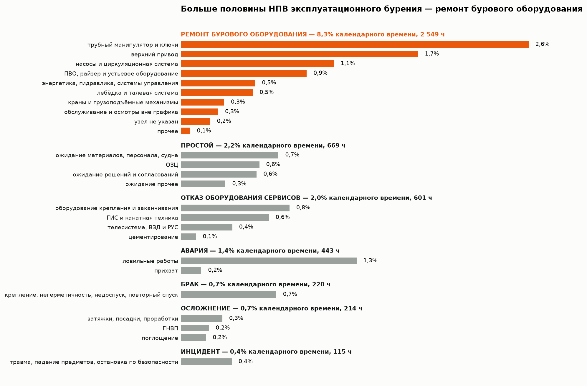
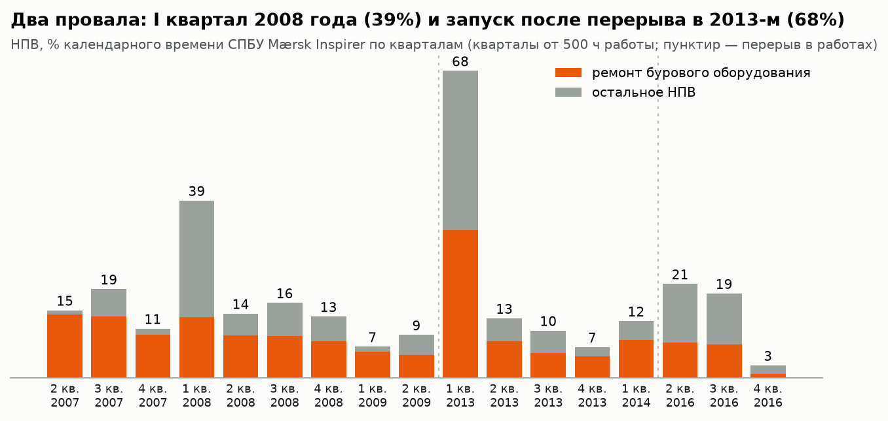
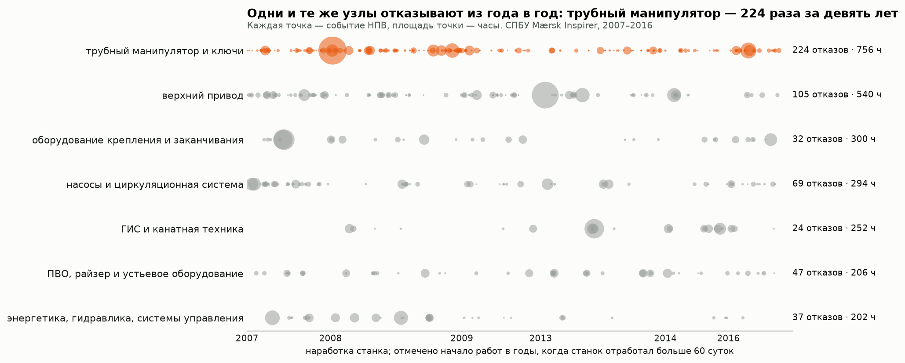
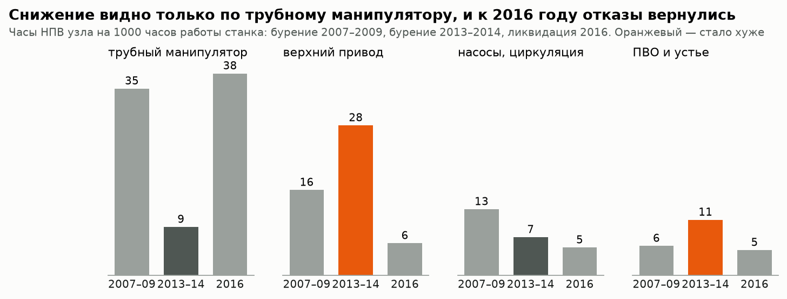
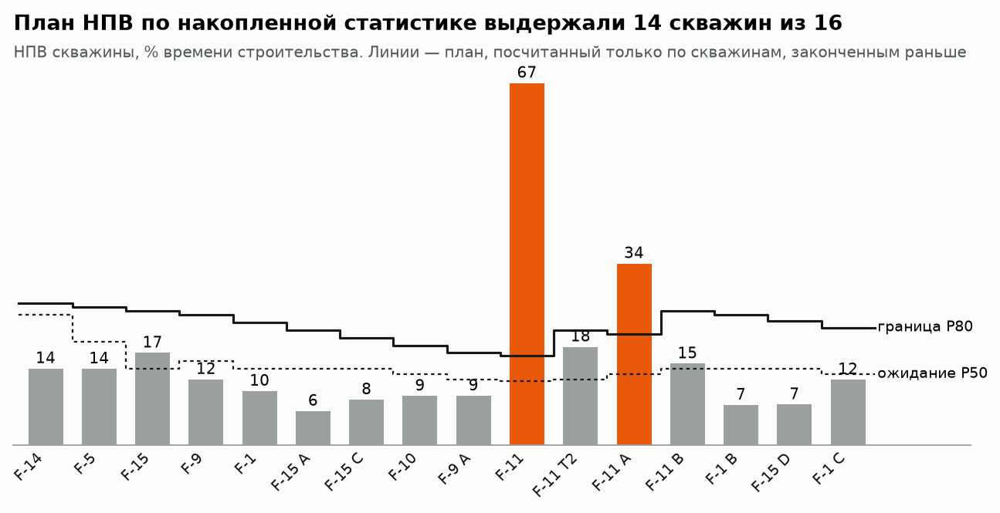
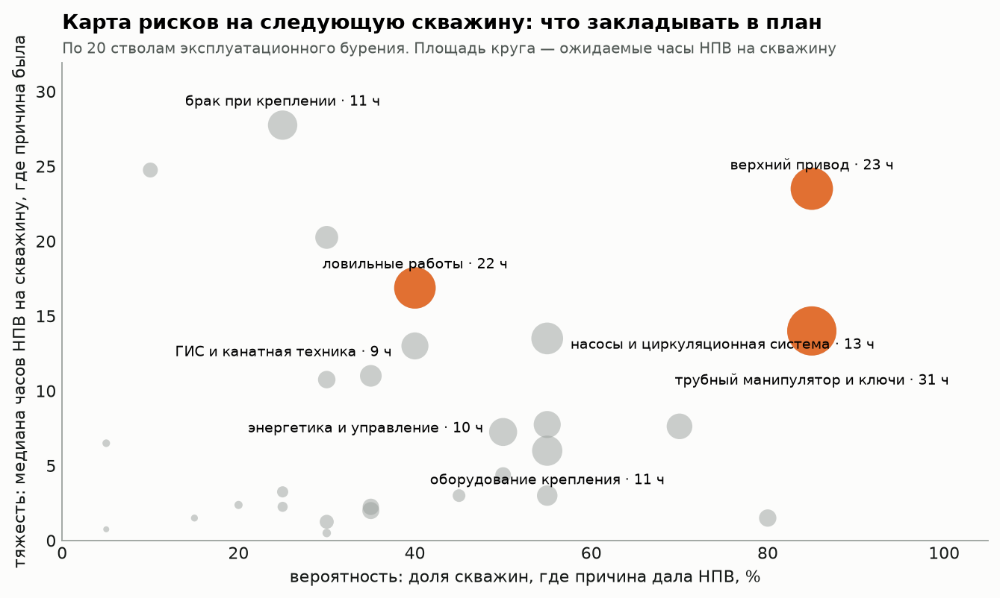
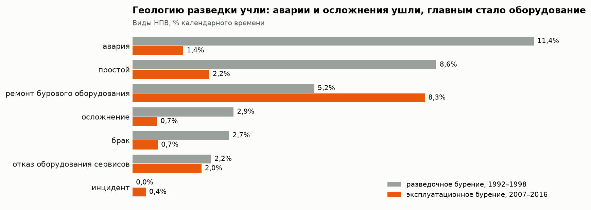
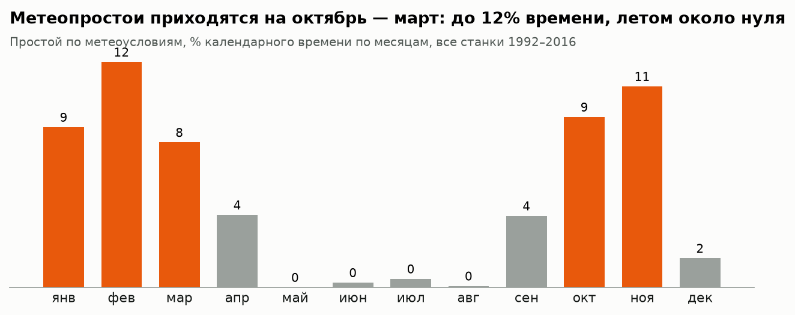

# НПВ при строительстве скважин Volve: классификация, повторяемость, план

Суточные рапорты месторождения Volve (Северное море, оператор Statoil, ныне Equinor) разобраны так, как НПВ ведут в процессе бурения: каждая операция отнесена к виду НПВ и причине, по каждому узлу собрана история отказов, по накопленной статистике посчитан план НПВ на следующую скважину и карта рисков.

Задача проекта — показать не «сколько потеряли за 24 года», а что из этих данных инженер и руководитель проекта видели бы месяц за месяцем, если бы вели такой учёт с первой скважины, и где с повторяющимися отказами работали, а где нет.

**Данные:** 1 758 суточных рапортов, 26 стволов, 23 447 операций, 1 641 сутки работы станков, 1992–2016 годы.
**Стек:** Python (pandas, NumPy, matplotlib) · DuckDB + SQL · регулярные выражения · бутстрэп · Jupyter.
**Автор:** Александр Царегородский, 10 лет в строительстве скважин (наземное бурение).

📓 [Ноутбук с расчётами](notebooks/analysis.ipynb) · 🗃 [SQL-витрины](sql/marts.sql) · 🧭 [Классификатор НПВ](src/volve/npt.py) · 📊 [Данные для дашборда](reports/marts)

## Объект

Одна площадь, три станка и два разных вида работ. Они считаются раздельно: в разведке разрез изучают, в эксплуатационном бурении его уже знают.

| | Разведочное бурение | Эксплуатационное бурение |
|---|---|---|
| Стволы | 15/9-19 S, ST2, A, B, BT2 — 5 стволов | 15/9-F — 21 ствол с одной платформы |
| Годы | 1992–1993, 1997–1998 | 2007–2009, 2013–2014, КРС до 2016, ликвидация в 2016 |
| Станки | ППБУ Treasure Prospect, ППБУ Byford Dolphin | СПБУ Mærsk Inspirer (она же добывающая платформа) |
| Календарное время | 364 сут | 1 278 сут |
| НПВ | 33,1% (7,9 ч/сут) | 15,7% (3,8 ч/сут) |
| Метеопростои | 5,1% | 4,8% |


## Учёт НПВ в рапортах и как он исправлен

Вида НПВ в рапортах Volve нет. Есть группа операций «прерывание» с кодом, отметка «успешно / отказ оборудования / операция не выполнена» и комментарий супервайзера. Разбирать причины по таким кодам нельзя:

- 35% НПВ записано под кодом «прочее», ещё 16% — под кодом «ремонт» без узла.
- 14% НПВ (1 063 ч) записано под плановыми кодами: подъём хвостовика труболовкой проходит как «спуск обсадной колонны», смена отказавшей телесистемы — как «СПО». В НПВ эти часы попадают только по отметке об отказе.

Каждая операция НПВ отнесена к виду и причине в три шага: по коду и отметке рапорта (19% и 7% часов), по описанию отказа в комментарии (51%), остальные операции события получают причину операции, с которой событие началось (23%). Работы «попутно» (после слова meanwhile) причиной не считаются. Без конкретной причины осталось 178 ч, 2,3% НПВ. Выборочная проверка 70 операций по комментариям: верно размечено около 9 из 10.

| Вид НПВ | Что сюда отнесено | Кто отвечает |
|---|---|---|
| Ремонт бурового оборудования | верхний привод, трубный манипулятор и ключи, лебёдка и талевая система, насосы, ПВО, краны, энергетика | буровой подрядчик |
| Отказ оборудования сервисов | телесистема, ВЗД и РУС, ГИС и канатная техника, оборудование крепления и заканчивания, цементирование | сервисные подрядчики |
| Осложнение | поглощение, ГНВП, затяжки, посадки, проработки | геология и технология |
| Авария | прихват, ловильные работы, перебуривание ствола | геология и технология |
| Брак | негерметичность колонны, недоспуск, повторный спуск, повторное испытание | качество работ |
| Простой | ожидание материалов, персонала, судна, решений; ОЗЦ сверх плана; забастовка | организация работ |
| Инцидент | травма, падение предметов, остановка работ по безопасности | организация работ |
| Метеопростой | ожидание погоды, учитывается отдельно от НПВ | — |

Определения осложнения, аварии, брака и инцидента — по учебному пособию «Предупреждение и ликвидация осложнений, аварий и брака при строительстве скважин» и ФЗ-116.

## Эксплуатационное бурение, СПБУ Mærsk Inspirer

### 1. Структура НПВ

НПВ — 15,7% календарного времени (95% интервал 14,3–17,1%), 4 812 ч за 1 278 суток.



- **Ремонт бурового оборудования — 53% НПВ**, 8,3% календарного времени. Четыре узла дают три четверти ремонтов: трубный манипулятор и ключи, верхний привод, насосы, ПВО.
- Простои — 14% НПВ, отказы оборудования сервисов — 12%, аварии — 9%, брак — 5%, осложнения — 4%, инциденты — 2%.
- Аварии и осложнения вместе — 2,1% календарного времени. Разрез проблем почти не создаёт, время уходит на железо и организацию.

Событий НПВ 837, медианное длится 1 ч 45 мин. 39 событий дольше суток дают 43% НПВ. Крупнейшие:

| Скважина | Дата | Часы | Что произошло |
|---|---|---|---|
| F-4 | март 2008 | 142 | Хвостовик 7" не посажен: подъём труболовкой, повторный спуск |
| F-12 | январь 2008 | 139 | Разрушена кабельная цепь трубного манипулятора, ремонт задержан погодой |
| F-12 | январь 2008 | 136 | Негерметичность колонны-надставки 10¾": поиск места, пакер, перфоратор НКТ |
| F-12 | сентябрь 2007 | 142 | Негерметичность подвески и резьб надставки 10¾": подъём и повторный спуск колонны |
| F-11 | март 2013 | 126 | Ремонт верхнего привода и цементный мост после слома КНБК |
| F-11 T2 | март 2013 | 105 | Заклинил подшипник шкива кронблока, замена шкива |
| F-4 | февраль 2008 | 88 | Прихват прибора на кабеле в стволе 8½", извлечение по методу cut and thread |
| F-11 | март 2013 | 79 | Слом КНБК 36" по корпусу яса, расширитель остался в скважине, ловильные работы |

### 2. Динамика



- Рабочий уровень НПВ — 7–16% в квартал.
- I квартал 2008 года — 39%: в одном квартале сошлись ремонт манипулятора, негерметичная надставка на F-12 и две аварии на F-4.
- I квартал 2013 года — 68%: станок вышел на бурение после почти четырёх лет без проходки и на первой же скважине получил слом КНБК, ремонт верхнего привода и замену шкива кронблока.
- Ликвидация скважин в 2016 году — 19–21%: растут простои в ожидании оборудования и решений.

### 3. Работали ли с повторяющимися отказами



Третий отказ верхнего привода записан на девятые сутки работы станка, третий отказ трубного манипулятора — на тринадцатые. Повторяемость была видна с первого месяца. Что с ней сделали, показывает удельное НПВ узла:



- **Трубный манипулятор:** 35 ч НПВ на 1000 ч работы в 2007–2009 годах, 9 ч в 2013–2014. По годам: 41 отказ в 2007-м, 80 в 2008-м (402 ч), 23 в 2009-м. Проблему решили, но на третий год. Если бы уровень 2013–2014 годов держали с начала работ, первая программа бурения сберегла бы около 400 ч, или 17 суток станка. В 2016 году отказы вернулись — 38 ч на 1000 ч.
- **Верхний привод:** 16 ч на 1000 ч в первой программе, 28 ч во второй. Стало хуже, лишние 117 ч.
- **ПВО и устье:** 6 → 11 ч. Насосы: 13 → 7 ч.

Вторая сквозная проблема — **колонна-надставка 10¾"**. НПВ, связанное с ней, записано на 7 стволах из 21: 13 событий, 442 ч. На F-12 она дала 277 ч в сентябре 2007-го и январе 2008-го, затем повторилась на F-5 (август 2008), F-15 C (2009), F-1 C (2014) и при ликвидации F-15 D (2016). В рапортах 310 ч из 442 записаны плановым кодом «спуск обсадной колонны», остальное — кодами «прочее» и «ремонт», поэтому в сводках по кодам её не видно.

### 4. План НПВ на скважину и карта рисков

Проверка «как было бы»: перед каждой скважиной план НПВ считается только по скважинам, законченным раньше. Медиана — ожидание, 80-й перцентиль — граница.



14 скважин из 16 уложились в границу. Не уложились две первые после перерыва 2009–2013 годов: F-11 (67%) и F-11 A (34%). Статистика по работающему станку не описывает запуск после долгого простоя — под него нужен отдельный запас времени и приёмка оборудования до забуривания.



На одну скважину в среднем 190 ч НПВ, медиана 130 ч, 80-й перцентиль 247 ч. Что закладывать:

| Причина | Доля скважин | Ожидаемое НПВ на скважину |
|---|---|---|
| Трубный манипулятор и ключи | 85% | 31 ч |
| Верхний привод | 85% | 23 ч |
| Ловильные работы | 40% | 22 ч |
| Насосы и циркуляционная система | 55% | 13 ч |
| Оборудование крепления и заканчивания | 55% | 11 ч |
| Брак при креплении | 25% | 11 ч (28 ч, если случился) |

## Разведочное бурение, 1992–1998

НПВ — 33,1% календарного времени. Структура другая: 22 события дольше суток дают 80% НПВ.



- **Аварии — 11,4% времени.** 15/9-19 S, декабрь 1992: прихват на 2 741 м в стволе 12¼", ловильные работы, ствол перебурен (ST2) — около 630 ч. 15/9-19 B, ноябрь 1997: поглощение на 3 035–3 054 м, затем полная потеря циркуляции и прихват на 3 248 м в стволе 8½", ствол перебурен (BT2) — около 290 ч.
- **Простой — 8,6%.** Почти целиком забастовка осенью 1997 года: 750 ч, 31 сутки на 15/9-19 A.
- **Брак — 2,7%.** Испытание пласта на ST2 в апреле 1993-го: пакер не сел, испытательная колонна негерметична, три повторных спуска. Недоспуск хвостовика 7" на BT2.

В эксплуатационном бурении аварии и осложнения занимают 2,1% времени против 14,3% в разведке. Геологические риски разведки при проектировании эксплуатационных скважин учли. Ремонты выросли с 5,2% до 8,3%: главным источником НПВ стал станок.

## Метеопростои



4,9% календарного времени, почти всё с октября по март: в феврале 12,5%, в ноябре 11,1%, с июня по август меньше 1%. Погода останавливает не бурение, а работы с краном, судами и на высоте — в январе 2008 года она задержала ремонт манипулятора.

## Мероприятия

1. **Учёт.** Вид НПВ и узел — обязательные поля рапорта. Код «прочее» дольше часа не принимать. Работы после отказа кодировать как НПВ, а не плановой операцией.
2. **Реестр повторяющихся отказов.** Третий отказ одного узла — основание для разбора причины и ППР, а не для очередного ремонта. По манипулятору это решение запоздало на два года и стоило 17 суток.
3. **Запуск станка после простоя.** Приёмка талевой системы, верхнего привода и манипулятора до забуривания и отдельный запас времени на первую скважину.
4. **Колонна-надставка 10¾".** Разбор после F-12 с изменением порядка спуска и опрессовки до следующей скважины.
5. **План НПВ.** На каждую скважину — P50 и P80 по накопленной статистике, карта рисков — в программу бурения, еженедельное сравнение факта с планом.
6. **Сезон.** Работы с краном и судами обеспечения с октября по март планировать с запасом на погоду 10–12%.

## Ограничения

- Причины размечены правилами по тексту, а не актами расследования: точность около 90%, длинное событие с несколькими отказами отнесено к причине с наибольшим временем.
- Отнесение НПВ к подрядчику сделано по виду НПВ. Договоров и актов в данных нет.
- Плановой продолжительности и норм времени в рапортах нет, поэтому скрытое НПВ (операции дольше нормы) не оценено.
- Стоимости суток в данных нет, потери посчитаны во времени.
- Один станок в эксплуатационном бурении: цифры описывают Mærsk Inspirer, а не морское бурение в целом.
- План НПВ посчитан по 16 скважинам, интервалы широкие.

## Как устроен проект

1. **Загрузка** ([build_db.py](src/volve/build_db.py)): рапорты разворачиваются в таблицы DuckDB `reports` и `operations`.
2. **Баланс времени** ([marts.sql](sql/marts.sql)): правило ПВ / НПВ / метео записано в SQL.
3. **Этапы** ([analysis.py](src/volve/analysis.py)): разведка и эксплуатация, строительство, КРС, ликвидация.
4. **Классификатор НПВ** ([npt.py](src/volve/npt.py)): вид, причина, событие, источник разметки.
5. **Повторяемость, план НПВ, карта рисков** ([analysis.py](src/volve/analysis.py)).
6. **Графики и витрины** ([report.py](src/volve/report.py), [figures.py](src/volve/figures.py)).

```bash
make all
```

Нужны Python 3.12 и [uv](https://docs.astral.sh/uv/). Команда собирает базу, графики, CSV для BI и выполняет ноутбук.

## Источники

Данные: Volve Data Village, Equinor ASA и партнёры лицензии Volve, Equinor Open Data Licence. Рапорты взяты в формате parquet из набора [bengsoon/volve_daily_drilling_report](https://huggingface.co/datasets/bengsoon/volve_daily_drilling_report) (CC BY 4.0).

Классификация: «Предупреждение и ликвидация осложнений, аварий и брака при строительстве скважин», учебное пособие; Федеральный закон № 116-ФЗ «О промышленной безопасности опасных производственных объектов».
