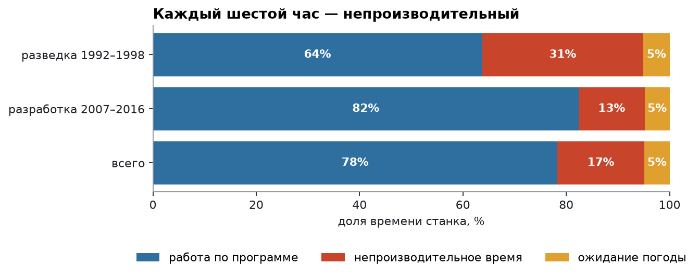
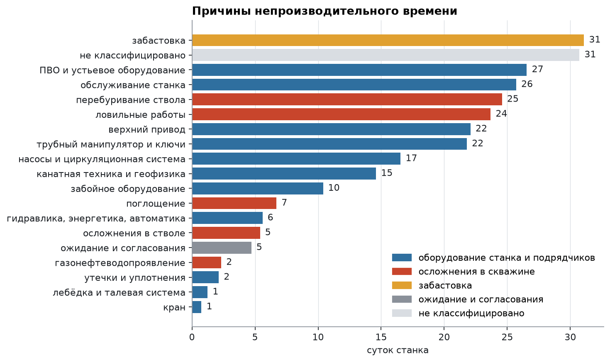
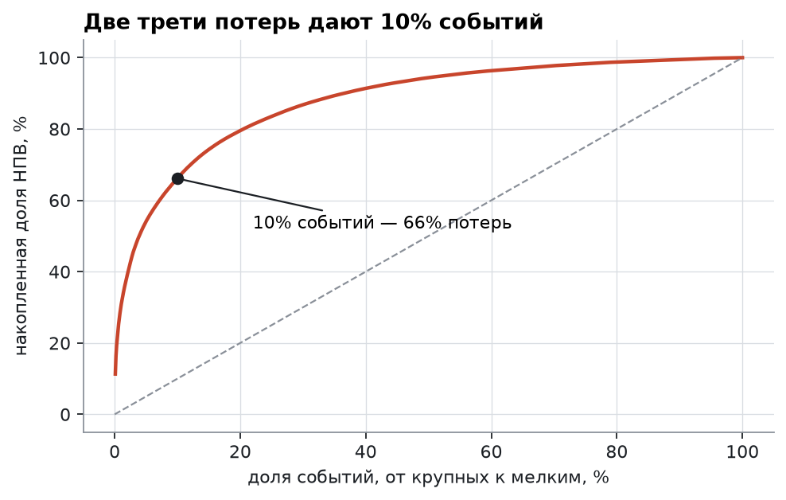
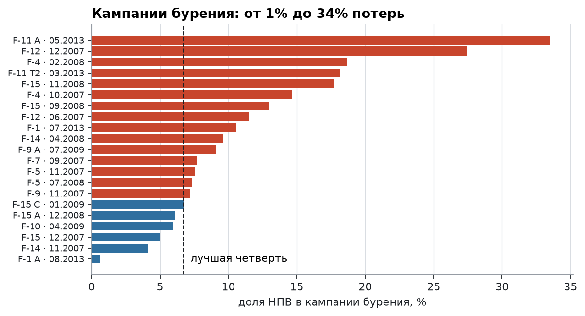

# Куда уходит время на буровой

Сутки работы морской буровой стоят сотни тысяч долларов, поэтому главный ресурс проекта — время станка. Проект отвечает на три вопроса: на что уходит это время, где оно теряется и какие потери можно убрать.

**Данные:** суточные буровые рапорты месторождения Volve в Северном море, открытые оператором Equinor: 1 758 рапортов, 26 стволов, 23 447 операций за 1992–2016 годы (1 641 сутки работы станка).

**Стек:** Python (pandas, NumPy, matplotlib) · DuckDB + SQL · регулярные выражения · бутстрэп · Jupyter

**Автор:** Александр Царегородский. До аналитики 10 лет строил скважины, поэтому вопросы к данным здесь те же, что задаёт руководитель бурового проекта.

📓 [Ноутбук с анализом](notebooks/analysis.ipynb) · 🗃 [SQL-витрины](sql/marts.sql) · 📊 [Данные для дашборда](reports/marts)

## Главные выводы



**1. Каждый шестой час станка — непроизводительный.** НПВ — 16,8% времени, ещё 4,9% — ожидание погоды. В разведке потери в 2,4 раза выше, чем в эксплуатационном бурении: 31% против 13%, разница 18 п.п. (95% интервал 14–23 п.п.).

**2. Код причины в рапортах не работает.** 40% потерь записаны как «прочее», ещё 18% — как «ремонт» без указания узла. Причины восстановлены по комментариям супервайзеров, неизвестная доля снизилась до 11%.



**3. Крупнейшая потеря пряталась в «прочем».** Это забастовка 1997 года: 31 сутки простоя на одном стволе, 11% всех потерь за 24 года.

**4. Разведка и разработка теряют время по-разному.** В разведке 41% потерь — осложнения в скважине. В эксплуатационном бурении 74% потерь даёт оборудование, а осложнения — 10%. Четверть всех потерь приходится на три узла: ПВО, верхний привод и трубный манипулятор.

**5. Потери — это редкие крупные события.** Медианный простой длится 1 час 45 минут, но 10% событий дают 66% потерь, а 45 событий дольше суток — больше половины.



**6. Резерв бурения — до 40 суток из 711.** Столько времени сберегли бы 21 кампания эксплуатационного бурения, если бы каждая теряла не больше, чем лучшая четверть (6,7%). Это верхняя граница организационного резерва, а не прогноз.



## Рекомендации оператору

- Ввести обязательный код узла оборудования для каждого простоя и запретить «прочее» дольше часа.
- Каждое событие дольше суток разбирать отдельно: их 45, и они дают больше половины потерь.
- Сосредоточить профилактику на ПВО, верхнем приводе и трубном манипуляторе.
- Работы, чувствительные к погоде, планировать на май — август: зимой погода отнимает до 12% времени, летом меньше 1%.

## Как устроен проект

1. **Загрузка** ([build_db.py](src/volve/build_db.py)). Вложенные рапорты разворачиваются в две таблицы DuckDB: `reports` и `operations`. Значение `-999.99` заменяется на пропуск.
2. **Витрины** ([marts.sql](sql/marts.sql)). Правило разметки времени записано в SQL: работа по программе, НПВ, погода. Там же баланс по стволам и причины потерь.
3. **Кампании** ([analysis.py](src/volve/analysis.py)). Ствол живёт долго: бурение, заканчивание, ремонты, ликвидация. Рапорты разбиты на непрерывные серии, тип серии определяет группа операций с наибольшим временем.
4. **Причины по тексту.** 14 правил по ключевым словам в комментариях; первое совпадение побеждает.
5. **События.** Подряд идущие операции НПВ объединены в событие.
6. **Статистика.** Доли НПВ и их разница оценены бутстрэпом по суткам.

## Запуск

Нужны Python 3.12 и [uv](https://docs.astral.sh/uv/).

```bash
make all
```

Команда собирает базу, выполняет ноутбук с графиками и выгружает CSV для BI.

## Ограничения

- Причины размечены правилами, а не вручную: часть операций могла попасть не в свою категорию, 11% НПВ остались без причины.
- Интервалы бутстрэпа не учитывают зависимость соседних суток на одном стволе, настоящий разброс шире.
- Одно месторождение и три установки: переносить выводы на другие проекты без проверки нельзя.
- Стоимости суток в данных нет, поэтому потери посчитаны во времени, а не в деньгах.
- Диаметр ствола указан в 44% рапортов, сравнение секций построено только на них.

## Источник данных

Volve Data Village, Equinor ASA и партнёры лицензии Volve. Данные распространяются по Equinor Open Data Licence. Рапорты взяты в формате parquet из набора [bengsoon/volve_daily_drilling_report](https://huggingface.co/datasets/bengsoon/volve_daily_drilling_report) (CC BY 4.0).
